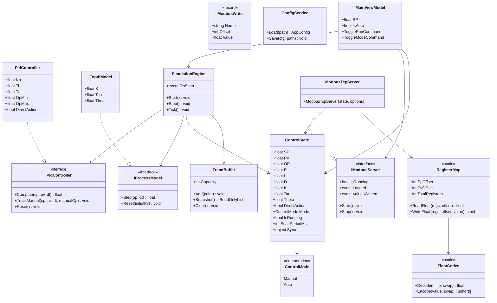
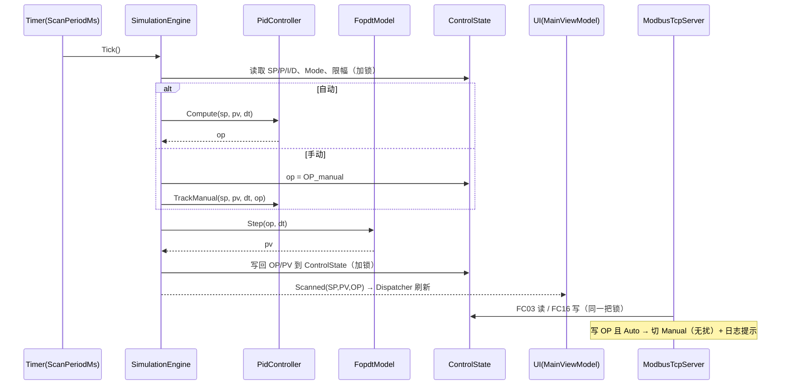

# PID 模拟器（Windows 桌面应用）— 功能开发与界面设计文档

| 项目 | 内容 |
|------|------|
| 文档名称 | PID 模拟器 功能开发与界面设计文档 |
| 版本 | v1.1（与实现对齐） |
| 日期 | 2026-11-06 |
| 技术栈 | C# / .NET 8 (WPF) |
| 文档状态 | 已实现（代码骨架） |

---

## 1. 项目概述

### 1.1 背景与目标
开发一款运行于 Windows 桌面的 **PID 控制器模拟器**。用户可在界面上实时设置与观察 PID 控制器参数（SP、OP、P、I、D），并内置一个可调的**过程仿真模型（被控对象）**，形成完整闭环；同时对外提供一个 **Modbus TCP 服务端（127.0.0.1:502）**，支持上位机/PLC 通过标准 Modbus TCP 协议对上述参数进行读写，用于教学演示、联调测试、上位机组态验证等场景。

### 1.2 核心目标
1. **闭环 PID 仿真**：SP、P、I、D 可在界面设置并实时显示，OP 由 PID 计算或手动给定。
2. **过程仿真可调**：内置 FOPDT（一阶惯性 + 纯滞后）模型，模拟现场被控对象，产生过程值 PV。
3. **手/自动切换与无扰切换**：自动由 PID 计算 OP，手动由界面或 Modbus 给定 OP。
4. **Modbus TCP 服务**：在 `127.0.0.1:502` 提供 Modbus TCP 从站（Server/Slave），提供以下 float 型保持寄存器（PV 只读，其余可读写）：

   | 变量 | 含义 | 地址（参考号） | 类型 | 访问 |
   |------|------|----------------|------|------|
   | SP | 设定值 | 4001 | float32 | R/W |
   | OP | 输出值 | 4003 | float32 | R/W |
   | P  | 比例增益 | 4005 | float32 | R/W |
   | I  | 积分时间 Ti | 4007 | float32 | R/W |
   | D  | 微分时间 Td | 4009 | float32 | R/W |
   | PV | 过程值 | 4011 | float32 | 只读 |

5. **界面友好**：参数直观可调、趋势曲线实时刷新、状态一目了然。

### 1.3 名词解释
| 缩写 | 全称 | 说明 |
|------|------|------|
| SP | Set Point | 设定值（目标值） |
| PV | Process Value | 过程测量值（被控对象输出） |
| OP | Output | 控制器输出（0–100%） |
| Kp | Proportional Gain | 比例增益 |
| Ti | Integral Time | 积分时间（秒） |
| Td | Derivative Time | 微分时间（秒） |
| FOPDT | First-Order Plus Dead Time | 一阶惯性 + 纯滞后过程模型 |
| MBAP | Modbus Application Protocol | Modbus TCP 报文头 |

### 1.4 交付范围
- 本文档定义 **第一版（v1.1）** 的功能范围、算法、Modbus 协议、界面布局与验收要点。
- 不包含：多回路、报警联锁、历史数据持久化、远程控制、用户权限等（列入第 13 章后续扩展）。

---

## 2. 总体架构

### 2.1 技术栈选型

| 层 | 选型 | 说明 |
|----|------|------|
| 运行平台 | Windows 10/11 (x64) | .NET 8 桌面运行时 |
| UI 框架 | WPF（.NET 8） | 原生 Windows 观感，MVVM 模式 |
| 趋势图 | 内置 `Polyline`（代码绘制） | 零第三方依赖、简化部署；后续可平滑替换为 OxyPlot |
| Modbus 服务端 | 自实现轻量 Modbus TCP Server（基于 `System.Net.Sockets.TcpListener`） | 零第三方依赖、可控；亦可选 EasyModbusTCP |
| 打包 | `dotnet publish` + 单文件 / MSIX | 生成独立 exe |

> **架构决策**：Modbus TCP **服务端**在 .NET 生态中缺少成熟稳定库（NModbus 主要为客户端），故采用**自定义轻量实现**，仅实现本项目所需的 FC03/FC06/FC16，代码量小、可控性强、无授权风险。

### 2.2 系统架构图

```
┌───────────────────────────────────────────────────────────────┐
│                        WPF 主进程                               │
│                                                               │
│  ┌─────────────┐    ┌──────────────┐    ┌─────────────────┐   │
│  │   View 层    │◄──►│  ViewModel   │◄──►│  Core (Model)   │   │
│  │  (XAML UI)  │    │  (MVVM)      │    │  Data Store     │   │
│  └─────────────┘    └──────────────┘    └────────┬────────┘   │
│                                                   │ 读写        │
│  ┌───────────────────────────────────────────────▼──────────┐ │
│  │              Simulation Engine（仿真引擎线程）             │ │
│  │   ┌──────────┐   OP   ┌──────────────┐  PV  ┌──────────┐  │ │
│  │   │ PID 控制器│ ─────► │ FOPDT 过程模型│ ───► │ 数据/趋势 │  │ │
│  │   └──────────┘        └──────────────┘      └──────────┘  │ │
│  └───────────────────────────────────────────────────────────┘ │
│                                                   ▲ 读写        │
│  ┌────────────────────────────────────────────────┴──────────┐ │
│  │        Modbus TCP Server（后台监听线程，127.0.0.1:502）      │ │
│  │        接收 FC03/FC06/FC16 ⇄ 寄存器映射表（float↔ushort[]）  │ │
│  └───────────────────────────────────────────────────────────┘ │
└───────────────────────────────────────────────────────────────┘
                 ▲
                 │ Modbus TCP (TCP 502)
        ┌────────┴────────┐
        │  上位机 / PLC /  │
        │  Modbus Poll 等  │
        └─────────────────┘
```

### 2.3 模块划分

| 模块 | 职责 |
|------|------|
| `PidSimulator.App` | WPF 启动、依赖注入、窗口 |
| `PidSimulator.ViewModels` | MVVM ViewModel，命令与属性绑定 |
| `PidSimulator.Core` | 数据模型、参数校验、状态管理 |
| `PidSimulator.Engine` | 仿真引擎：PID 运算 + FOPDT 模型 + 定时扫描 |
| `PidSimulator.Modbus` | Modbus TCP 服务端、寄存器映射、编解码 |
| `PidSimulator.Config` | 配置文件加载/保存（JSON） |

### 2.4 线程模型与数据流

| 线程 | 职责 | 关键点 |
|------|------|--------|
| UI 线程 | 渲染界面、响应操作 | 通过 `Dispatcher` 更新绑定 |
| 仿真线程 | 定时（默认 100ms）执行 PID + FOPDT + 写寄存器 | `System.Threading.Timer` 或专用线程，固定节拍 |
| Modbus 线程 | 监听 502 端口、处理客户端请求 | 每个客户端一个处理任务，读写共享寄存器 |

**数据流（每次扫描）**：
1. 读取当前 SP / P / I / D（可能来自界面或 Modbus 写入）。
2. 读取 PV（上一周期过程模型输出）。
3. PID 计算 → OP（自动）或直接取手动 OP（手动）。
4. OP 写入过程模型 → 经过 FOPDT 延时/惯性 → 得到新 PV。
5. 将 SP/OP/P/I/D 及 PV 写回共享数据区（`ControlState`），并通过事件通知 UI 刷新。

**共享数据并发**：核心数据区（`ControlState`）以 `Sync` 锁保护；Modbus 读请求在锁内**按需由 `ControlState` 构建寄存器快照**后组包，保证一次 `FC03` 多寄存器读取的一致性（不维护常驻寄存器镜像）。

---

## 3. 功能需求

### 3.1 功能清单

| 编号 | 功能 | 优先级 | 说明 |
|------|------|--------|------|
| F-01 | SP 设置与显示 | P0 | 界面输入 + 滑块，Modbus 读写 |
| F-02 | P/I/D 设置与显示 | P0 | 界面输入，Modbus 读写，实时生效 |
| F-03 | OP 显示 | P0 | 自动模式只读显示，手动模式可编辑 |
| F-04 | 自动/手动切换 | P0 | 带无扰切换 |
| F-05 | PID 闭环运算 | P0 | 离散位置式，含抗饱和、微分先行 |
| F-06 | FOPDT 过程仿真 | P0 | 增益/时间常数/滞后可调 |
| F-07 | PV 实时显示与趋势 | P0 | PV/SP/OP 三条曲线 |
| F-08 | Modbus TCP 服务 | P0 | 127.0.0.1:502，FC03/06/16 |
| F-09 | 运行/暂停仿真 | P1 | 暂停后 PV/OP 冻结，参数仍可改 |
| F-10 | 参数复位/恢复默认 | P1 | 一键恢复出厂参数 |
| F-11 | 通信状态与日志 | P1 | 显示客户端连接与最近读写 |
| F-12 | 配置保存/加载 | P2 | JSON 配置持久化 |
| F-13 | Modbus 写入回显 | P0 | 外部写入后界面实时刷新，并记录到日志 |

### 3.2 PID 控制功能
- 支持 **正作用 / 反作用** 切换。**默认反作用**（`e = SP − PV`，PV 升高则 OP 降低），适用于"OP 增大使 PV 增大"的正增益过程（如加热，默认 K=1.0）；正作用取 `e = PV − SP`。详见 4.1。
- P、I、D 参数可在运行中随时修改，实时生效。
- OP 限幅：默认 `[0, 100]`，可配置。
- SP 限幅：默认 `[0, 100]`（工程单位可配置）。

### 3.3 过程仿真（FOPDT）
- 过程增益 `K`、时间常数 `τ`、纯滞后 `θ` 可配置。
- 可选叠加测量噪声、初始 PV。
- 仿真步长 = 扫描周期（默认 100ms）。

### 3.4 手/自动与无扰切换
- **自动（Auto）**：`OP = PID(SP, PV, P, I, D)`。
- **手动（Manual）**：`OP = 手动给定值`（界面输入或 Modbus 写入），PID 积分项跟随（tracking），保证切回自动瞬间无扰。
- **切换规则**：
  - 手动 → 自动：以当前手动 OP 初始化积分项，使输出连续（bumpless）。
  - 自动 → 手动：冻结当前 OP 作为手动初值。

### 3.5 参数与限幅默认值

| 参数 | 默认值 | 范围 | 单位/说明 |
|------|--------|------|-----------|
| SP | 50.0 | 0–100 | 工程单位 |
| OP | 0.0 | 0–100 | % |
| P (Kp) | 2.0 | 0–1000 | 比例增益 |
| I (Ti) | 10.0 | 0–10000 | 积分时间 s（0=无积分） |
| D (Td) | 0.0 | 0–10000 | 微分时间 s（0=无微分） |
| K（过程增益） | 1.0 | 0.01–1000 | 过程模型 |
| τ（时间常数） | 10.0 | 0.1–10000 | s |
| θ（纯滞后） | 1.0 | 0–1000 | s |
| 扫描周期 | 100 | 10–1000 | ms |

> 参数为 **float32**，通过 Modbus 读写时遵循 IEEE-754 单精度。

---

## 4. PID 算法设计

### 4.1 变量与符号约定
- **作用方向**：默认**反作用**，误差 `e(k) = SP(k) − PV(k)`（PV 高于 SP 时减小 OP），适用于"OP 增大使 PV 增大"的正增益过程（默认 K=1.0，如加热）。若过程为负增益（如制冷），切换为**正作用** `e(k) = PV(k) − SP(k)`。方向由配置项 `DirectAction` 控制（默认 `false`）。
- 采样周期：`dt`（秒）= 扫描周期 / 1000。
- 参数：`P = Kp`（比例增益）；`I = Ti`（积分时间，秒）；`D = Td`（微分时间，秒）。

> **约定说明**：`I` 采用工业习惯的**积分时间 Ti**（秒），`D` 采用**微分时间 Td**（秒）。
> - 积分增益 `Ki = Kp / Ti`；`Ti = 0` 表示积分作用关闭。
> - 微分增益 `Kd = Kp · Td`；`Td = 0` 表示微分作用关闭。
> - 若后续希望 `I/D` 直接作为增益（Ki、Kd），可在配置中切换解释模式（当前已确认采用 Ti/Td 模式）。

### 4.2 离散化实现（位置式 PID）
```
e(k)      = SP(k) − PV(k)
P_term    = Kp · e(k)
I_term(k) = I_term(k−1) + (Kp / Ti) · e(k) · dt          (Ti > 0)
D_term    = Kp · Td · (PV(k−1) − PV(k)) / dt            (微分先行，作用于 PV)
u(k)      = P_term + I_term(k) + D_term
OP(k)     = clamp(u(k), OP_min, OP_max)
```
- **微分先行（Derivative on Measurement）**：微分项对 PV 求导而非对误差求导，避免 SP 阶跃时产生"微分冲击（derivative kick）"。

### 4.3 积分抗饱和（Anti-windup）
采用**条件积分 + 积分项限幅**组合策略：
1. **条件积分**：当 `u` 已饱和（达到 OP_min/OP_max）且误差方向仍推动其继续饱和时，暂停积分累加。
   - 饱和在上限且 `e(k) > 0` → 不累加积分；
   - 饱和在下限且 `e(k) < 0` → 不累加积分。
2. **积分项钳位**：将 `I_term` 限制在 `[OP_min − (P+D), OP_max − (P+D)]` 的等价区间内，防止长时间饱和后积分过大导致超调。
3. （可选）**反算法（back-calculation）**：`I_term += (OP_clamped − u) · dt / Tt`，作为进阶选项。

### 4.4 无扰切换（Bumpless Transfer）
- **手动 → 自动**（切换瞬间）：
  ```
  // 令输出在切换点连续
  I_term = OP_manual − P_term − D_term
  ```
- **自动 → 手动**：
  ```
  OP_manual = OP_auto(当前值)   // 冻结当前输出
  ```
- 每次进入手动模式，`I_term` 持续跟踪为 `OP_manual − P_term − D_term`，保证随时可无扰切回。

### 4.5 扫描周期
- 仿真引擎以固定节拍 `dt` 运行（默认 100ms）。
- 采用**固定 dt**（而非实际流逝时间），确保仿真可重复；如需贴近实时，可用实际 `Stopwatch` 差值但需限幅。

### 4.6 伪代码
```csharp
void Scan() {
    float dt = scanPeriodMs / 1000f;
    float e = directAction ? (pv - sp) : (sp - pv);   // 默认 false = 反作用

    float pTerm = kp * e;
    float dTerm = kp * td * (prevPv - pv) / dt;   // 微分先行

    if (mode == Auto) {
        // 抗饱和：判断是否需要积分
        float uUnclamped = pTerm + iTerm + dTerm;
        bool satHigh = uUnclamped >= opMax && e > 0;
        bool satLow  = uUnclamped <= opMin && e < 0;
        if (ti > 0 && !satHigh && !satLow)
            iTerm += (kp / ti) * e * dt;
        // 积分项钳位：使 u = P + I + D 不越界
        iTerm = Clamp(iTerm, opMin - (pTerm + dTerm), opMax - (pTerm + dTerm));
        op = Clamp(pTerm + iTerm + dTerm, opMin, opMax);
    } else {
        op = opManual;
        // 无扰跟踪
        iTerm = op - pTerm - dTerm;
    }

    prevPv = pv;
    WriteState();     // 写回共享数据区（Modbus 读时按需构建寄存器快照）
}
```

---

## 5. 过程仿真模型（FOPDT）

### 5.1 数学描述
一阶惯性 + 纯滞后传递函数：
```
G(s) = K · e^(−θs) / (τs + 1)
```
- `K`：过程增益
- `τ`：时间常数（s）
- `θ`：纯滞后时间（s）

### 5.2 离散实现
- **纯滞后**：将 OP 存入长度为 `N = round(θ / dt)` 的环形缓冲区，取滞后 `N` 步的输出作为输入 `u_delay`。
- **一阶惯性**（精确离散，推荐）：
  ```
  a = exp(−dt / τ)
  y(k) = a · y(k−1) + (1 − a) · K · u_delay(k)
  ```
  - `a` 为惯性系数；`dt → 0` 时 `a → 1`，输出平滑。
- **输出**：`PV = y(k)`（可叠加噪声 `n(t)` 与偏置 `b`）。

### 5.3 参数与默认值
| 参数 | 默认 | 范围 | 说明 |
|------|------|------|------|
| K | 1.0 | 0.01–1000 | 过程增益 |
| τ | 10.0 s | 0.1–10000 | 时间常数 |
| θ | 1.0 s | 0–1000 | 纯滞后 |
| PV 初值 | 0.0 | 0–100 | 初始过程值 |
| 噪声幅值 | 0.0 | 0–10 | 可选测量噪声峰值 |

---

## 6. Modbus TCP 服务设计

### 6.1 网络与协议
| 项目 | 取值 |
|------|------|
| 监听地址 | `127.0.0.1`（仅本机，已确认；不支持局域网访问） |
| 端口 | `502`（固定，标准 Modbus TCP 端口；绑定失败则弹错提示） |
| 协议 | Modbus TCP（MBAP 报文头 + PDU），无校验（TCP 自带） |
| Unit ID（从站号） | 默认 `1`，兼容 `0` / `255` |
| 最大并发连接 | 默认 5（可配置） |

### 6.2 寄存器地址映射

**地址映射（已确认约定：4001 = 3 号功能码寄存器地址 0，即 PDU 偏移 = 地址号 − 4001）**

| 变量 | 参考号 (4xxxx) | PDU 起始偏移 | 占用寄存器 | 数据类型 | 访问 |
|------|----------------|--------------|------------|----------|------|
| SP | 4001 | 0 | 0–1 | float32 | R/W |
| OP | 4003 | 2 | 2–3 | float32 | R/W |
| P  | 4005 | 4 | 4–5 | float32 | R/W |
| I  | 4007 | 6 | 6–7 | float32 | R/W |
| D  | 4009 | 8 | 8–9 | float32 | R/W |
| PV | 4011 | 10 | 10–11 | float32 | **只读** |

> **地址说明（已确认）**：`4001` 即 **3 号功能码（保持寄存器）地址 0**（40001 参考号基）。即 **`PDU 偏移 = 地址号 − 4001`**，每个 float 占 2 个连续保持寄存器，寄存器区从偏移 0 开始，共 **12** 个寄存器（偏移 0–11）。

**示例**：一次读取全部 6 个变量，用 `FC03` 从偏移 **0** 起、数量 **12** 个寄存器读取，得到 12 个 `ushort`，两两还原为 6 个 float。

> **只读说明**：`PV`（4011–4012）为只读区，读取始终返回实时过程值；对其写入（`FC06`/`FC16`）返回异常码 `0x02`（IllegalDataAddress）。

### 6.3 数据类型与字节序
- 每个变量为 **IEEE-754 单精度 float（32-bit）**，占 **2 个连续保持寄存器**。
- **字序（已确认）：大端 ABCD**（寄存器 N 存高 16 位，N+1 存低 16 位）。
  - 例：`float 50.0` → 十六进制 `0x42480000` → 寄存器 N=`0x4248`，N+1=`0x0000`。
- 可配置**字序交换（CDAB）**，以适配按低字在前的设备。

### 6.4 功能码支持
| 功能码 | 名称 | 支持 | 用途 |
|--------|------|------|------|
| 0x03 | Read Holding Registers | ✅ | 读取 SP/OP/P/I/D/PV |
| 0x06 | Write Single Register | ✅ | 写单个 16 位寄存器（半字） |
| 0x10 (16) | Write Multiple Registers | ✅ | 写多个寄存器（一次写完整 float，推荐） |
| 其他 | — | ❌ | 返回异常码 01（非法功能） |

**异常响应**：非法地址 / 写只读区（PV）→ 异常码 `02`；非法数据 → `03`；数量越界 → `03`。

### 6.5 读写行为与手自动联动

| 场景 | 行为 |
|------|------|
| 读 SP/OP/P/I/D/PV | 始终返回实时值 |
| 写 SP | 实时生效（受 SP 限幅约束） |
| 写 P / I / D | 实时生效；负值拒绝或钳位到 0（Ti/Td 不得为负） |
| 写 OP（**手动模式**） | 接受并作为手动输出保持，界面同步显示 |
| 写 OP（**自动模式**） | **已确认策略**：接受写入并**自动切换到手动模式**（无扰），界面提示"外部写入 OP，已切换手动" |
| **写 PV（只读）** | **拒绝**：返回异常码 `02`，PV 值不变 |
| 写入超范围 | 拒绝（返回异常）或钳位到合法范围（可配置，默认钳位） |

> **写入回显与日志**：任何实际生效的写入都会（1）触发 `ValuesWritten` 事件 → 界面相应控件**即时刷新**；（2）记录日志 `Modbus 写入：<字段> = <值>（地址 <4xxx>）`。仅记录**值真正发生变化**的写入，避免重复写同值刷屏。

> **原子性提示**：用 `FC06` 写 float 需分两次写（高字、低字），中间态可能被读到，非原子。**推荐上位机使用 `FC16` 一次性写 2 个寄存器**，保证 float 原子写入。程序内部对寄存器写入与读取加锁，避免读到"半更新"的值。

### 6.6 并发与异常处理
- 每个 TCP 连接独立处理；读请求整体加锁拷贝相关寄存器后再组包，保证一次多寄存器读取的一致性。
- 客户端断开自动回收，异常不中断服务。
- 端口占用/绑定失败：界面提示，记录日志，仿真引擎继续运行（仅 Modbus 服务不可用）。

### 6.7 测试方法
- 使用 **Modbus Poll / QModMaster / ModbusPal** 等工具：
  1. 连接 `127.0.0.1:502`，Unit ID = 1。
  2. 读保持寄存器：起始 `0`（PDU 偏移）数量 12，验证 SP=50.0、OP、P=2.0、I=10.0、D=0.0 及 PV。
  3. 写寄存器：用 FC16 写 0–1 = 80.0（SP），观察界面 SP、日志与趋势变化。
  4. 写 2–3（OP）：自动模式下验证是否切手动。
  5. 读 10–11（PV）：验证返回实时过程值；写 10–11（PV）：验证被拒绝（异常 `90 02`）。
- 单元测试：float↔ushort[] 编解码、地址越界、异常码、只读保护、写入回显事件。

---

## 7. 界面设计

### 7.1 设计原则
- **一眼看懂**：参数、状态、趋势同屏呈现，主次分明。
- **操作顺畅**：数值输入 + 滑块/步进，实时生效。
- **状态可见**：手/自动、运行/暂停、Modbus 连接状态用颜色指示灯区分。
- **工业风但不呆板**：深色系 + 强调色，兼顾专业与美观。

### 7.2 主界面布局（线框图）

```
┌──────────────────────────────────────────────────────────────────────────┐
│ PID 模拟器            运行状态：暂停仿真   模式：自动仿真   Modbus:502 已监听 │  ← 顶部状态栏
├───────────────────────┬──────────────────────────────────────────────────┤
│  参数设置              │            实时趋势（PV / SP / OP）                │
│  SP 设定值 (4001)      │   ┌────────────────────────────────────────────┐  │
│  [ 50.00 ]             │   │                                            │  │
│  P 比例增益 (4005)     │   │      ╱╲    PV(蓝)                          │  │
│  [  2.000 ]            │   │  ╱╲╱  ╲   SP(橙)                          │  │
│  I 积分时间 s (4007)   │   │ ╱      ╲____  OP(绿)                      │  │
│  [ 10.00 ]             │   └────────────────────────────────────────────┘  │
│  D 微分时间 s (4009)   │                    时间 ──►                        │
│  [  0.00 ]             ├──────────────────────────────────────────────────┤
│  OP 输出 % (4003)      │  过程值 & 输出                                    │
│  [ 0.00 ]              │   PV 过程值(4011)  OP 输出%(4003)  SP 设定值(4001) │
│  [自动仿真] [暂停仿真]  │      99.98            100.00         100.00       │
│  [恢复默认] [保存配置]  │                                                  │
│  [清空趋势] [清空日志]  │                                                  │
├───────────────────────┴──────────────────────────────────────────────────┤
│ 过程模型(FOPDT) K[1.00] τ[10.0] θ[1.0] 扫描周期[100]ms │ Modbus 日志(倒序) │
│                                                        │ 14:03 写入 SP=80 │
└──────────────────────────────────────────────────────────────────────────┘
```

### 7.3 控件清单

| 区域 | 控件 | 说明 |
|------|------|------|
| 顶部状态栏 | 运行状态 / 模式 / Modbus 监听状态 文本 | 即时反映当前状态（如"模式：自动仿真"） |
| 左侧-参数区 | SP 设定值 **(4001)** 输入框 | 实时写 SP |
| 左侧-参数区 | P 比例增益 **(4005)** / I 积分时间 s **(4007)** / D 微分时间 s **(4009)** 输入框 | 实时生效，负值校验 |
| 左侧-参数区 | OP 输出 % **(4003)** 只读框 | 自动模式只读；手动或 Modbus 写入后刷新 |
| 左侧-参数区 | 自动仿真 / 手动仿真 切换按钮 | 触发无扰切换，文字随状态变化 |
| 左侧-参数区 | 暂停仿真 / 开始仿真、恢复默认、保存配置 按钮 | 控制仿真与参数 |
| 左侧-参数区 | 清空趋势、清空日志 按钮 | 分别清空曲线与日志 |
| 中部-趋势区 | 内置 Polyline 折线图 | PV/SP/OP 三线 |
| 底部-读数区 | PV 过程值 **(4011)** / OP 输出 % **(4003)** / SP 设定值 **(4001)** 大数字 | 实时读数，标签含 Modbus 地址 |
| 底部-模型区 | K / τ / θ / 扫描周期 输入框 | 调整过程模型 |
| 底部-日志区 | Modbus 日志列表（**倒序，最新置顶**） | 连接 / 写入 / 模式切换等事件 |

### 7.4 交互与状态
- **参数输入**：失焦/回车即生效，非法输入（非数字、越界）高亮并回滚。
- **手/自动**：切换瞬间执行无扰逻辑，OP 连续。
- **运行/暂停**：暂停时停止扫描，PV/OP 冻结，仍可改参数与 Modbus 读写。
- **Modbus 写入联动**：外部写 OP（自动态）→ 自动切手动并在日志/提示区提醒。
- **写入回显**：Modbus 写入生效后，界面相应控件（SP/P/I/D/OP、模式）**即时刷新**，并写入日志。
- **日志顺序**：日志**按时间倒序**显示（最新一条置顶），可点击「清空日志」清空。
- **异常提示**：端口占用、连接异常以非模态提示条显示。

### 7.5 视觉风格
- 深色背景（#1E1E2E），卡片式分区，圆角 8px，柔和阴影。
- 强调色：主色蓝 #4A9EFF，PV 蓝 / SP 橙 / OP 绿。
- 数字使用等宽字体（Consolas / Cascadia Mono），便于读数稳定。
- 指示灯带轻微呼吸动效（可选）。

### 7.6 趋势图
- 三条曲线对应 PV（蓝）、SP（橙，阶梯线）、OP（绿）。
- **数据缓冲区：默认 600 点**（@100ms ≈ 60s 历史），可通过配置项 `TrendBufferSize` 设置；超出容量按环形覆盖。
- 显示时间窗可调（30s/60s/300s），支持暂停/清空。
- 显示当前值图例；采样点与扫描周期同步。

---

## 8. 数据模型与配置

### 8.1 核心数据模型（示意）
```csharp
public class ControlState {
    public float SP, PV, OP;
    public float P, I, D;          // Kp, Ti, Td
    public float K, Tau, Theta;    // 过程模型
    public bool IsAuto;
    public bool IsRunning;
    public bool DirectAction;      // false=反作用(默认), true=正作用
    public int ScanPeriodMs = 100;
    // 注：不维护常驻寄存器镜像（Modbus 读时按需构建 12 个寄存器快照）
    public readonly object Sync = new();
}
```

### 8.2 配置文件（appsettings.json 示意）
```json
{
  "Modbus": {
    "ListenAddress": "127.0.0.1",
    "Port": 502,
    "UnitId": 1,
    "MaxConnections": 5,
    "WordSwap": false,
    "OpWriteInAuto": "SwitchToManual"
  },
  "Pid": { "DirectAction": false, "OpMin": 0, "OpMax": 100 },
  "Process": { "K": 1.0, "Tau": 10.0, "Theta": 1.0, "Noise": 0.0 },
  "Ui": { "TrendWindowSec": 60, "TrendBufferSize": 600 }
}
```

---

## 9. 打包与部署

| 项目 | 方案 |
|------|------|
| 目标框架 | .NET 8 (Windows Desktop) |
| 打包命令 | `dotnet publish -c Release -r win-x64 --self-contained -p:PublishSingleFile=true` |
| 产物 | 单个 `PidSimulator.exe`（自包含运行时，免装 .NET），随附 `appsettings.json` |
| 发布目录 | `publish/win-x64/`（另有可删的 `.pdb` 调试符号） |
| 端口权限 | 固定 502（1024 以下，属特权端口）；普通用户通常可监听，若绑定失败请以管理员身份运行 |
| 首次启动 | 读取默认配置；若 502 绑定失败则弹错提示（必要时以管理员身份运行） |

---

## 10. 默认参数汇总表

| 参数 | 默认 | 范围 | 单位 |
|------|------|------|------|
| SP | 50.0 | 0–100 | 工程单位 |
| OP | 0.0 | 0–100 | % |
| P | 2.0 | 0–1000 | — |
| I | 10.0 | 0–10000 | s |
| D | 0.0 | 0–10000 | s |
| K | 1.0 | 0.01–1000 | — |
| τ | 10.0 | 0.1–10000 | s |
| θ | 1.0 | 0–1000 | s |
| 扫描周期 | 100 | 10–1000 | ms |
| 作用方向 | 反作用（e=SP−PV） | — | — |

---

## 11. 验收 / 测试要点

1. **参数读写**：界面改 SP/P/I/D 立即生效；Modbus 读回值与界面一致（float 精度）。
2. **Modbus 地址**：按 6.2 映射，FC03 从偏移 0 读 12 寄存器可正确还原 6 个 float（SP=0–1、OP=2–3、P=4–5、I=6–7、D=8–9、PV=10–11）。
3. **float 编解码**：`50.0 ↔ 0x4248/0x0000`；负值、0、极小/极大值正确。
4. **闭环**：自动模式给定 SP，PV 能稳定跟踪；调 Kp 增大振荡加剧、调大 Ti 响应变慢，符合直觉。
5. **无扰切换**：自动↔手动切换时 OP 无跳变。
6. **抗饱和**：OP 长时间饱和后回退无严重超调。
7. **Modbus 写 OP**：自动模式下写入触发切手动（已确认策略）。
8. **PV 只读**：读 10–11 返回实时 PV；写 10–11 返回异常 `02` 且 PV 不变。
9. **写入回显**：Modbus 写入后界面即时刷新，日志按倒序新增记录。
10. **异常**：非法地址/功能码返回正确异常码；端口占用有提示。
11. **单元测试**：代码库含 34 个用例（编解码、地址、限幅、闭环、无扰、只读、端到端）全部通过。
12. **稳定性**：连续运行 30 分钟内存/CPU 平稳，趋势不卡顿。

---

## 12. 设计决策与假设（均已确认）

| 编号 | 事项 | 结论 | 备注 |
|------|------|------|------|
| Q1 | Modbus 地址基准 | ✅ 已确认：4001 = FC03 寄存器地址 0，`PDU 偏移 = 地址号 − 4001` | — |
| Q2 | I / D 含义 | ✅ 已确认：I=积分时间 Ti(s)、D=微分时间 Td(s)，Ki=Kp/Ti | — |
| Q3 | 自动态写 OP | ✅ 已确认：接受写入并自动切手动（无扰） | — |
| Q4 | 端口 502 占用 | ✅ 已确认：固定 502；绑定失败弹错提示，必要时以管理员身份运行 | — |
| Q5 | 是否监听 0.0.0.0 | ✅ 已确认：仅 127.0.0.1（本机） | — |
| Q6 | 字序 | ✅ 已确认：大端 ABCD（IEEE-754 标准，高位在前） | — |
| Q7 | PV 是否映射 Modbus | ✅ 已确认：PV 映射到 **4011**，**只读**（写返回异常 02） | — |

> 上表 6 项决策均已确认，作为本设计基线；相关配置项仍保留，便于后续切换。

---

## 13. 后续可扩展（非本期范围）

- 多回路 / 串级 PID；
- 报警与联锁、OP 变化率限幅；
- 历史数据记录与导出（CSV）；
- PID 自整定（Ziegler-Nichols 等）；
- Modbus RTU（串口）支持；
- 脚本/场景回放。

---

## 14. 类结构与接口设计（指导编码）

> 本章给出可直接落地到编码的类图与关键方法签名。接口先行，便于单元测试与后续替换实现。

### 14.1 命名空间与项目映射

| 命名空间 | 所属项目 | 主要内容 |
|----------|----------|----------|
| `PidSimulator.Core` | Core | `ControlState`、`ControlMode`、参数校验 |
| `PidSimulator.Engine` | Engine | `PidController`、`FopdtModel`、`SimulationEngine`、`TrendBuffer` |
| `PidSimulator.Modbus` | Modbus | `ModbusTcpServer`、`RegisterMap`、`FloatCodec` |
| `PidSimulator.Config` | Config | `AppConfig` 及子配置、`ConfigService` |
| `PidSimulator.ViewModels` | ViewModels | `MainViewModel`、命令与绑定属性 |
| `PidSimulator.App` | App | `App`、`MainWindow`、依赖装配 |

### 14.2 类图



### 14.3 Core —— 共享数据模型

```csharp
namespace PidSimulator.Core;

public enum ControlMode { Manual, Auto }

/// <summary>全局共享状态；所有线程读写均通过 Sync 锁保护。</summary>
public sealed class ControlState
{
    // 控制量（PID）
    public float SP { get; set; } = 50f;
    public float PV { get; set; } = 0f;
    public float OP { get; set; } = 0f;
    public float P  { get; set; } = 2f;    // Kp
    public float I  { get; set; } = 10f;   // Ti (s)
    public float D  { get; set; } = 0f;    // Td (s)

    // 过程模型参数
    public float K { get; set; } = 1f;
    public float Tau { get; set; } = 10f;
    public float Theta { get; set; } = 1f;

    // 运行与模式
    public bool DirectAction { get; set; } = false;        // false=反作用(默认)
    public ControlMode Mode { get; set; } = ControlMode.Auto;
    public bool IsRunning { get; set; } = true;
    public int ScanPeriodMs { get; set; } = 100;

    // 限幅
    public float OpMin { get; set; } = 0f, OpMax { get; set; } = 100f;
    public float SpMin { get; set; } = 0f, SpMax { get; set; } = 100f;

    // 注：不维护常驻寄存器镜像（Modbus 读时按需构建快照）

    // 同步对象
    public readonly object Sync = new();
}
```

### 14.4 Engine —— 算法与仿真

```csharp
namespace PidSimulator.Engine;

public interface IPidController
{
    float Compute(float sp, float pv, float dt);                     // 自动：计算 OP
    void  TrackManual(float sp, float pv, float dt, float manualOp);  // 手动：积分跟踪
    void  Reset();
}

public sealed class PidController : IPidController
{
    public float Kp { get; set; } = 2f;
    public float Ti { get; set; } = 10f;
    public float Td { get; set; } = 0f;
    public float OpMin { get; set; } = 0f;
    public float OpMax { get; set; } = 100f;
    public bool  DirectAction { get; set; } = false;

    private float _integral;
    private float _prevPv;

    public float Compute(float sp, float pv, float dt) { /* 见 4.2 / 4.3 */ }
    public void  TrackManual(float sp, float pv, float dt, float manualOp)
    {   // 用当前参数算比例项，令积分使输出恰等于手动值 → 无扰
        float e = DirectAction ? pv - sp : sp - pv;
        _integral = manualOp - Kp * e;
    }
    public void  Reset() { _integral = 0f; _prevPv = 0f; }
}

public interface IProcessModel
{
    float Step(float op, float dt);   // 输入 OP，返回新 PV
    void  Reset(float initialPv);
}

public sealed class FopdtModel : IProcessModel
{
    public float K { get; set; } = 1f;
    public float Tau { get; set; } = 10f;
    public float Theta { get; set; } = 1f;

    private float _y;
    private readonly Queue<float> _delayLine = new();

    public float Step(float op, float dt) { /* 环形延时 + 一阶惯性，见 5.2 */ }
    public void  Reset(float initialPv) { _y = initialPv; _delayLine.Clear(); }
}

/// <summary>一次扫描的输出，供 UI/趋势订阅。</summary>
public readonly record struct ScanResult(float SP, float PV, float OP);

public interface ISimulationEngine
{
    bool IsRunning { get; }
    event Action<ScanResult>? Scanned;
    void Start();
    void Stop();
    void Tick();                     // 单次扫描（便于单元测试）
}

public sealed class SimulationEngine : ISimulationEngine, IDisposable
{
    public event Action<ScanResult>? Scanned;
    public bool IsRunning { get; }

    public SimulationEngine(ControlState state, IPidController pid,
                            IProcessModel proc, TrendBuffer trend);

    public void Start();             // 启动定时器（ScanPeriodMs 节拍）
    public void Stop();
    public void Tick();              // 读参数 → PID → 过程 → 写回寄存器
    public void Dispose();
}
```

### 14.5 趋势缓冲

```csharp
namespace PidSimulator.Engine;

public readonly record struct TrendPoint(DateTime Time, float SP, float PV, float OP);

public sealed class TrendBuffer
{
    public int Capacity { get; }                    // 默认 600，来自配置 TrendBufferSize

    public TrendBuffer(int capacity = 600);
    public void Add(in TrendPoint point);           // 环形覆盖
    public IReadOnlyList<TrendPoint> Snapshot();    // 供 UI 取一帧
    public void Clear();
}
```

### 14.6 Modbus —— 编解码与服务端

```csharp
namespace PidSimulator.Modbus;

/// <summary>寄存器映射常量与 float 读写辅助。</summary>
public static class RegisterMap
{
    public const int SpOffset = 0;   // SP 4001
    public const int OpOffset = 2;   // OP 4003
    public const int POffset  = 4;   // P  4005
    public const int IOffset  = 6;   // I  4007
    public const int DOffset  = 8;   // D  4009
    public const int PvOffset = 10;  // PV 4011（只读）
    public const int TotalRegisters = 12;

    public static float ReadFloat(ushort[] regs, int offset, bool wordSwap = false);
    public static void  WriteFloat(ushort[] regs, int offset, float value, bool wordSwap = false);
}

/// <summary>IEEE-754 单精度 ↔ 寄存器对编解码（ABCD / CDAB）。</summary>
public static class FloatCodec
{
    public static float  Decode(ushort hi, ushort lo, bool wordSwap);
    public static ushort[] Encode(float value, bool wordSwap);
}

public enum ModbusFunction : byte
{
    ReadHoldingRegisters   = 0x03,
    WriteSingleRegister    = 0x06,
    WriteMultipleRegisters = 0x10
}

public enum ModbusException : byte
{
    IllegalFunction     = 0x01,
    IllegalDataAddress  = 0x02,
    IllegalDataValue    = 0x03
}

/// <summary>一次写入造成的字段变更（用于界面回显与日志）。参考号 = 4001 + Offset。</summary>
public readonly record struct ModbusWrite(string Name, int Offset, float Value);

public interface IModbusServer
{
    bool IsRunning { get; }
    event Action<string>? Logged;                            // 通信日志
    event Action<bool>?  ListeningChanged;                   // 监听状态变化
    event Action<IReadOnlyList<ModbusWrite>>? ValuesWritten; // 外部写入变更（界面回显）
    void Start();
    void Stop();
}

/// <summary>服务端选项（由 App 从 ModbusConfig 映射，避免 Modbus → Config 反向依赖）。</summary>
public sealed record ModbusServerOptions
{
    public string ListenAddress { get; init; } = "127.0.0.1";
    public int    Port          { get; init; } = 502;
    public byte   UnitId        { get; init; } = 1;
    public int    MaxConnections{ get; init; } = 5;
    public bool   WordSwap      { get; init; } = false;
    public bool   OpWriteSwitchesToManual { get; init; } = true;
}

public sealed class ModbusTcpServer : IModbusServer, IDisposable
{
    public ModbusTcpServer(ControlState state, ModbusServerOptions options);
    public bool IsRunning { get; }

    public event Action<string>? Logged;
    public event Action<bool>?  ListeningChanged;
    public event Action<IReadOnlyList<ModbusWrite>>? ValuesWritten;

    public void Start();     // 绑定 127.0.0.1:502，启动 AcceptLoop
    public void Stop();
    public void Dispose();

    // 内部：
    //  - HandleClientAsync(TcpClient)：解析 MBAP + PDU，派发 FC03/06/16
    //  - 读：锁内由 ControlState 构建 12 寄存器快照（含 PV）
    //  - 写：锁内应用并收集变更，锁外记日志 + 触发 ValuesWritten（避免持锁回调 UI 死锁）
    //  - 写 OP 且当前为 Auto → 切 Manual（无扰）；写 PV（只读区）→ 异常 02
}
```

### 14.7 Config —— 配置模型与服务

```csharp
namespace PidSimulator.Config;

public sealed class AppConfig
{
    public ModbusConfig  Modbus  { get; set; } = new();
    public PidConfig     Pid     { get; set; } = new();
    public ProcessConfig Process { get; set; } = new();
    public UiConfig      Ui      { get; set; } = new();
}

public sealed class ModbusConfig
{
    public string ListenAddress { get; set; } = "127.0.0.1";
    public int    Port          { get; set; } = 502;
    public byte   UnitId        { get; set; } = 1;
    public int    MaxConnections{ get; set; } = 5;               // 默认 5 个连接
    public bool   WordSwap      { get; set; } = false;           // false=ABCD
    public string OpWriteInAuto { get; set; } = "SwitchToManual";
}

public sealed class PidConfig
{
    public bool  DirectAction { get; set; } = false;
    public float OpMin { get; set; } = 0f,  OpMax { get; set; } = 100f;
    public float SpMin { get; set; } = 0f,  SpMax { get; set; } = 100f;
}

public sealed class ProcessConfig
{
    public float K { get; set; } = 1f, Tau { get; set; } = 10f, Theta { get; set; } = 1f;
    public float Noise { get; set; } = 0f;
    public float InitialPv { get; set; } = 0f;
}

public sealed class UiConfig
{
    public int TrendWindowSec  { get; set; } = 60;
    public int TrendBufferSize { get; set; } = 600;             // 趋势缓冲默认 600 点
}

public sealed class ConfigService
{
    public AppConfig Load(string path);
    public void Save(AppConfig cfg, string path);
}
```

### 14.8 ViewModel —— 绑定与命令

```csharp
namespace PidSimulator.ViewModels;

public sealed partial class MainViewModel : ObservableObject
{
    // —— 绑定属性 ——
    public float SP { get; set; }              // 双向：写回 ControlState
    public float P  { get; set; }
    public float I  { get; set; }
    public float D  { get; set; }
    public float PV { get; }                   // 只读：来自 Scanned 事件
    public float OP { get; }                   // 只读（自动）/ 可写（手动）
    public bool  IsAuto { get; set; }
    public string ModeText { get; }            // "自动仿真" / "手动仿真"
    public bool  IsRunning { get; set; }
    public bool  IsModbusListening { get; }
    public string ModbusStatusText { get; }

    // —— 命令 ——
    public ICommand ToggleRunCommand    { get; }   // 运行/暂停
    public ICommand ToggleModeCommand   { get; }   // 自动/手动（无扰）
    public ICommand ResetParamsCommand  { get; }   // 恢复默认参数
    public ICommand SaveConfigCommand   { get; }
    public ICommand ClearTrendCommand   { get; }   // 清空趋势
    public ICommand ClearLogsCommand    { get; }   // 清空日志

    // —— 事件订阅 ——
    // engine.Scanned       += r => Dispatcher.Invoke(() => { PV/OP 更新; trend.Add(...); });
    // modbus.Logged        += s => Dispatcher.Invoke(() => 日志倒序追加);
    // modbus.ValuesWritten += w => Dispatcher.Invoke(() => 刷新 SP/P/I/D/OP/模式);
}
```

### 14.9 一次扫描的调用时序



### 14.10 线程与同步约定

| 约定 | 说明 |
|------|------|
| 唯一同步对象 | `ControlState.Sync`；仿真 Tick、Modbus 读写、参数变更全部加锁 |
| 锁粒度 | 单次操作尽量短；Modbus 读时在锁内一次性构建寄存器快照，保证多寄存器一致 |
| UI 更新 | 仅通过 `Dispatcher.Invoke/BeginInvoke`；引擎/Modbus 线程不直接触碰控件 |
| 事件 | `Scanned`/`Logged` 为轻量通知，订阅方自行切换线程 |
| 周期 | 定时器采用 `System.Threading.Timer`，`ScanPeriodMs` 变更后重建 |
| 不做的事 | 不在锁内做 IO（网络发送、UI 刷新） |

---

*文档结束 · v1.1*
